# RookStudio

[](https://github.com/jromang/rookstudio/actions/workflows/gui.yml)
[](https://github.com/jromang/rookstudio/actions/workflows/codeql.yml)
[](https://github.com/jromang/rookstudio/releases)


A chess program for your own games and for testing engines, in one window: databases of millions of games, the
notation written in place, the opening tree and your repertoires, Lichess, training and games against an engine, an
assistant that comments your games on your machine; and beside them, engine tournaments and SPRT tests played by
[fastchess](https://github.com/Disservin/fastchess), built into the program. No account is needed, everything works
offline, and what goes to the Internet is said where you choose it.


RookStudio is [fastchess-gui](https://github.com/jromang/fastchess-gui) grown into a complete chess program. Its pages
come in views, switched at the top of the rail on the left (Ctrl+1 to Ctrl+3). The first start offers three:

- Tests: engine testing, tournaments and SPRT, as fastchess-gui had them;
- Study: databases, the Board and its notation, the opening tree and repertoires, Lichess, training and play, the
  assistant and the reports;
- Everything: every page.

A view can hold the pages you choose, with its own name, icon and colour, and Ctrl+K finds any page, command, game,
database or section of the guide in all of them. At the first start, a fastchess-gui profile found on the machine is
copied if you wish (its engines, books, tournaments and settings); fastchess-gui stays as it is. The interface is in
English, French, German, Spanish, Italian, Brazilian Portuguese, Russian and simplified Chinese, in a light or a dark
theme, and the [user guide](docs/guide.md) is built in (see [Help](#help)).

RookStudio is in preview: its [releases](https://github.com/jromang/rookstudio/releases) are numbered
`0.7.0-preview.N` until it replaces fastchess-gui. Problems and ideas are welcome in the
[issues](https://github.com/jromang/rookstudio/issues).

Contents: [Study](#study) · [Tests](#tests) · [Help](#help) · [Downloads](#downloads) ·
[The assistant's model](#the-assistants-model) · [Privacy](#privacy) · [Building from source](#building-from-source) ·
[Roadmap](#roadmap) · [Licence and credits](#licence-and-credits)

## Study


The Home page puts first what runs and what you were doing: the game to resume where you left it (Enter), what to
start, the tournaments running, the recent games (Ctrl+Tab), your databases with the state of their opening tree,
your Lichess account and your games in progress there, and what the day's training has due.

### Databases and search

- Databases of millions of games, each a folder of its own, imported in the background at a low priority (a
  tournament playing beside the import loses no time): PGN files, or `.zst`, `.gz`, `.zip` and `.7z` archives of
  them. A damaged game is kept up to the move that cannot be read, and shown at its line in the file. Millions of
  games scroll and sort at once, and the quick filter takes free words (`carlsen 2024 B90`).
- ChessBase databases (CBH and 2CBH, and their CBV, CBZ, 2CBV and 2CBZ archives) copied into a RookStudio database,
  with their variations, comments, symbols, arrows and squares, clocks and evaluations; their files are only read.
- Games from their sources, only when you ask: The Week in Chess's issues, each Monday if you wish, a month of
  Lichess's games filtered while it downloads, a month of Lichess's broadcasts, a chess.com player's games, Lumbra's
  Gigabase from its `.7z`.
- The search panel (Ctrl+F) finds games by their headers, a position, a material balance, a pattern of men (built on a
  small board with conditions, or written in the words of CQL), a piece's manoeuvre or a pawn structure; long searches
  run in the background, the first games found listed at once. A search is kept by its name, for any database.
- Maintenance: the games that came twice from two sources, compared field by field and merged; a player's spellings
  brought together, with FIDE's rating list downloaded on a click; a database checked and compacted. Ctrl+Z undoes
  each.
- The tournaments of the profile and the PGN file on the Board are read as databases, without a copy.


### The Board and its notation

- The notation is written in place, without a dialog: Enter writes a comment after the move and Shift+Enter one before
  it, `!` and `?` put the symbols, a move other than the game's starts a variation, Alt+↑ moves it up, Delete deletes
  the moves from the one shown, and Ctrl+Z undoes each change. A move can be typed by its letters, those of the
  interface's language or the English ones.
- The right button draws arrows and squares in four colours, on the flat board and on the 3D one; they are saved in
  the PGN as other programs write them.
- The headers unfold in place (Alt+H); Ctrl+S saves the game where it came from, its database or its PGN file; Ctrl+Tab
  goes back to the recent games, Ctrl+← and Ctrl+→ to the previous and the next game of the list.
- Six tabs beside the board (Alt+1 to Alt+6): the notation; the analysis, up to four engines side by side, each with
  its colour and its arrow; the opening tree; the strongest games of the position; the assistant's questions; and what
  the endgame tables say once seven pieces or fewer are left.
- The practical move: among the moves the engine finds good, the one that scores best against a player of a level you
  choose, in the games of that level.
- A tournament's game shows its engines' evaluations and depths beside the moves, and the rest of what they said under
  the mouse.

### The opening tree and repertoires

- The Tree tab gives the moves played from the position in your databases added together, your Polyglot and CTG books
  and, with a linked account, Lichess's explorer (the masters, all its players, one player): their games, White's wins,
  draws and Black's wins, the score, the average rating, the performance and the last year played. When the game leaves
  your databases, it says at which move, and whether that move is a novelty.
- Repertoires are PGN files of your own, a star in the Tree tab adding a move to the active one. The Openings page
  measures a repertoire's coverage on your databases and lists its gaps, the most often met first, and trains it with
  spaced repetition (FSRS): each answer graded by itself, the positions you know coming back further apart.
- Theory studies, annotated PGN files and Lichess studies, show their notes in the Tree tab at each position they
  comment, reached by transposition too.

| The Tree tab: your databases added together, your repertoire's note under the moves | A repertoire: its positions to train today, its coverage on your databases, its gaps |
|---|---|
| 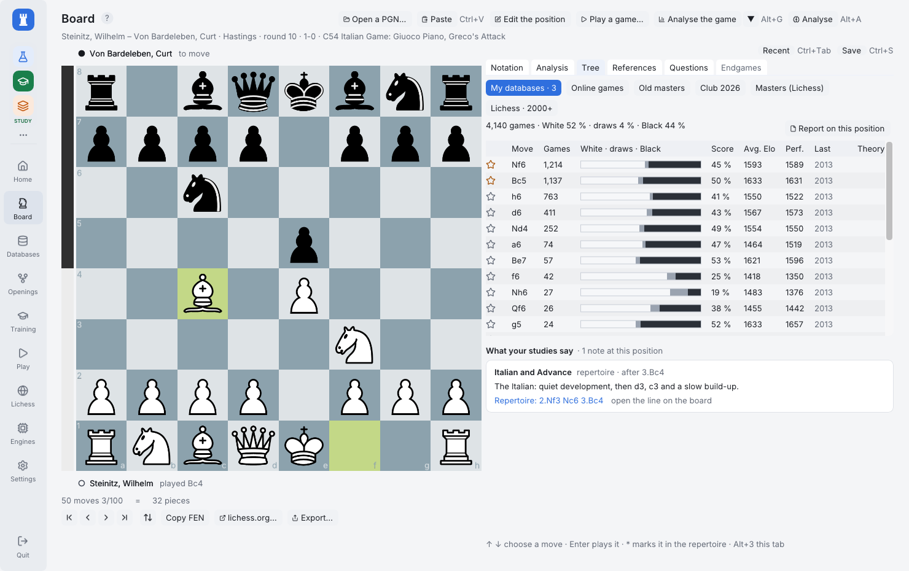 | 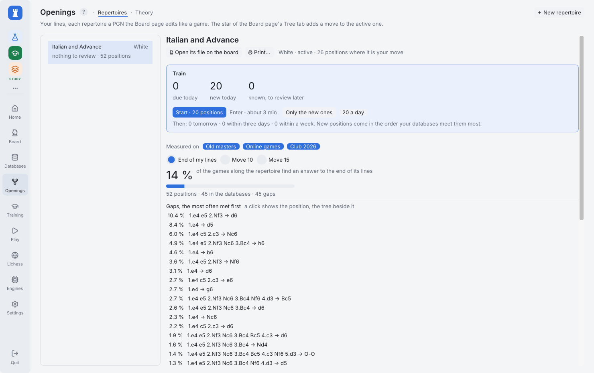 |

### Lichess

Everything here is optional, and each request is said where you choose it.

- An account linked in the browser, without giving RookStudio a password; its token stays in your profile, readable by
  you alone, and is revoked when you unlink it. A player's games, yours or another's, imported and synced into a
  database; your studies read, imported, followed and filled from the Board; a Lichess link pasted opens its game,
  study, broadcast or tournament.
- The official broadcasts, Lichess TV, the players you follow, Lichess's arenas and Swiss tournaments, followed live in
  a mosaic, each game analysed by your engine on your machine; a broadcast's standings and crosstable.
- Your games on Lichess played from the Board (rapid, classical, correspondence), challenges, arenas and Swiss
  tournaments. As Lichess's fair play asks, wherever you play: during a live game of yours, the engine, the tree, the
  tables, the cloud and the assistant are locked; a correspondence game locks the engine, the cloud, the tables and the
  assistant on its own positions.
- Lichess's cloud evaluations and its 7-piece tables, each asked for at its first use; its evaluations of 418 million
  positions kept on your disk, to answer offline.
- One of your engines as a Lichess bot, or offered to lichess.org's analysis board, computing on your machine.


### Training and play

- The Training page gathers what comes back today, each kind with its spaced repetition: the positions of your
  repertoires, the mistakes of your own games turned into exercises from their review, the puzzles and the endgames
  you missed.
- Lichess's puzzles: its whole database kept on your disk and solved without a network, by theme, opening and rating,
  with a rating of your own; or batches of your Lichess account, whose results go back to it.
- Guessing the moves of a game, scored by the engine; eighteen endgames to win or to hold against the tablebases, from
  the elementary mates to Lucena, Philidor and Vancura (the tables of your disk, those of 3 to 5 pieces downloaded on a
  click, or Lichess's online); mates by pattern; board vision: coordinates, blindfold games, a line read in your head.
- The Play page: a game against an engine of your library at the strength you choose, with its openings (your
  databases, your repertoire, a player's games, a book) and a handicap, takebacks and hints counted, the analysis and
  the assistant hidden until the end. A game left when RookStudio closes waits for you; at its end, its review, a
  rematch, and your results against that engine at that level.

| The Training page: the day's review and the exercises by kind | A puzzle of Lichess's database, solved offline |
|---|---|
| 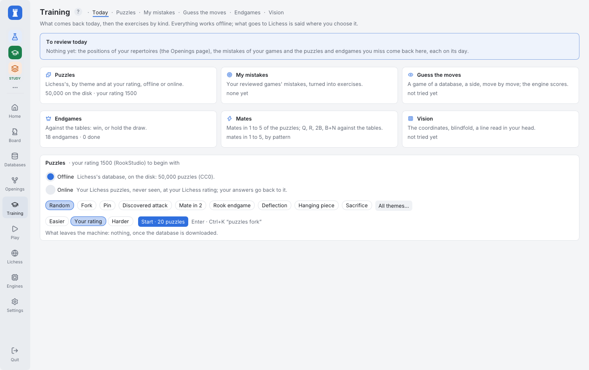 | 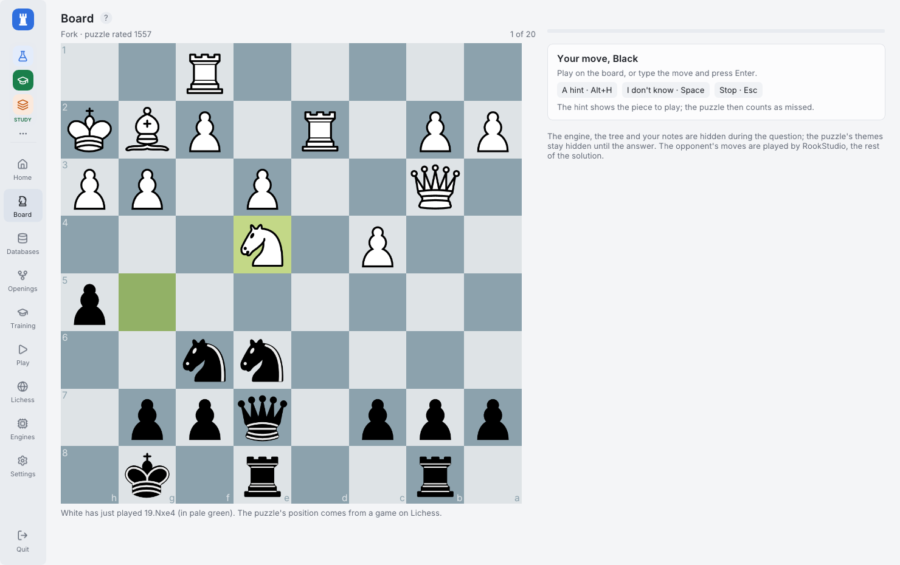 |

| The Play page: Gaia at 1500, its openings, the handicap, the clock | Endgames against the tablebases |
|---|---|
| 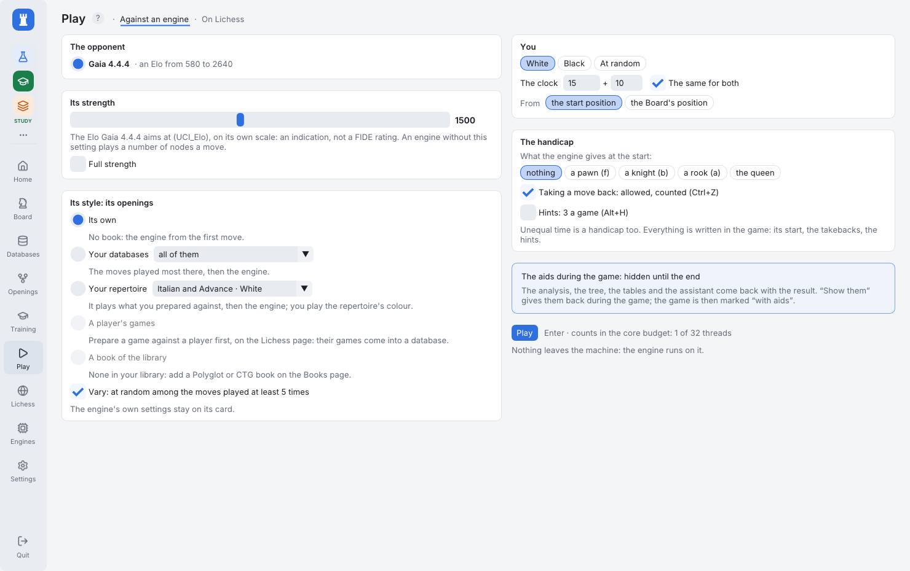 | 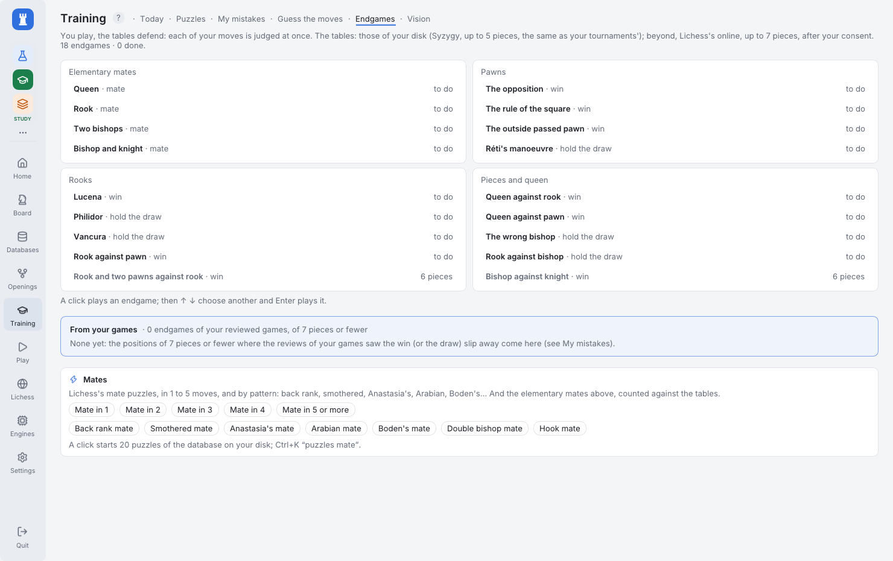 |

### The assistant and the review

- The review of a game (Alt+G) reads its analysis as a coach would: White's chances along the game, the key moments
  with the better move, the only moves, where the game left your databases' theory, the key moments in words, the story
  of the game and what to work on. The same game always gets the same review: each position is searched for a number of
  nodes, from a fresh start, so that the result depends on the engine and the position alone.
- The assistant comments a move (Alt+C) or every key moment, tells the story of the game, explains every move, takes
  you through the key moments asking what you would have played, answers "Why not?" (Alt+Q), and answers questions about
  the position: the best move, the threat, the opening, the reference games, what the tables say. It speaks only of what
  your engine, your databases and the tables establish: each of its sentences is checked against them, and one the
  checker refuses gives way to a template's. It writes in English or in French.
- Its comments show apart from yours, in blue grey, and are marked as its own in the PGN; a comment already there,
  yours, Lichess's or an annotator's, is never replaced.
- It runs on your machine, with a model downloaded once, when you ask (see [The assistant's
  model](#the-assistants-model)); without it, templates write the comments from the same facts, and everything else
  works.


### Reports and publishing

- The opening report of a position: its moves with their figures and evaluations, the main lines, the pawn structures
  and the plans of the next fifteen moves in your games, the key games, the novelties, and a summary by the assistant
  held to those figures.
- A player's dossier: their openings with White and with Black, their rating over the years, their pawn structures,
  your games against them, and the lines your repertoires leave unanswered against them; with their Lichess games
  beside, to prepare a game.
- The crosstable of a tournament of a database, or of a broadcast followed: round robin or Swiss, FIDE's tie-breaks, the
  performance and the rating change, and what is wrong with the data (a game missing, a player under two names, games
  come twice), each with its fix.
- Export: a page of HTML in one file, which replays the game offline, on a phone too; a diagram in PNG or SVG
  (Ctrl+Shift+C copies it); an animated GIF; a PDF made by RookStudio, its text selectable, to print; a PGN with the
  players' names as the database's table of names writes them. Repertoires, dossiers, reports and crosstables print
  too.

| The opening report of the Italian Game after 3.Bc4 | The crosstable of a Swiss tournament, its tie-breaks and what is wrong with its data |
|---|---|
| 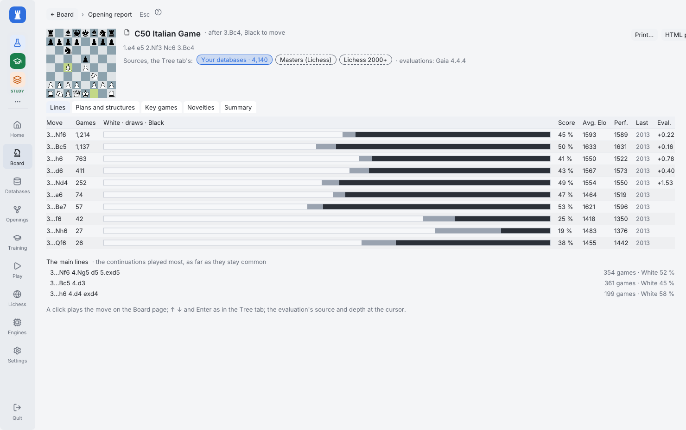 | 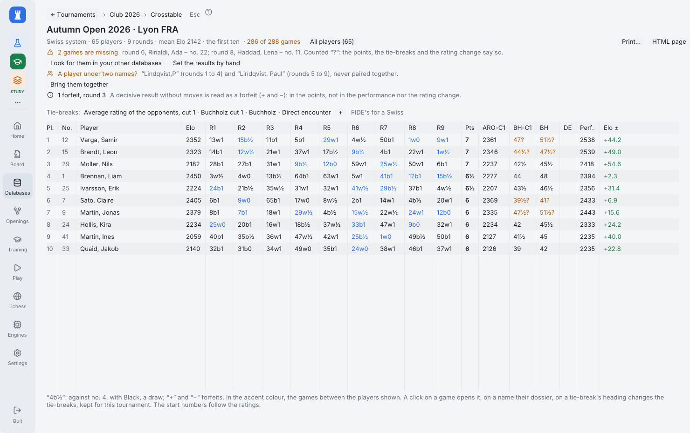 |

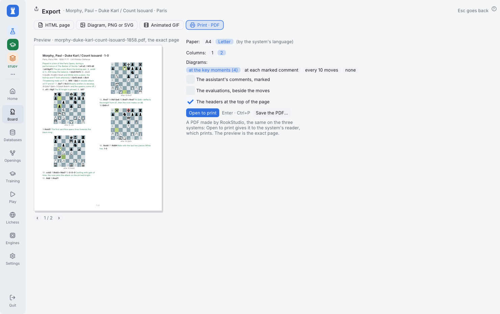

## Tests

The Tests view is fastchess-gui as its users know it. Two jobs: measuring whether a new version of an engine is
stronger than the last one (pick two engines, start an SPRT, follow Elo and LLR as results come in), and running engine
tournaments (round robin, gauntlet, Swiss, knockout, team match) that resume exactly after any interruption, can be
changed while they run and can be broadcast live. The tournament engine is fastchess itself, built into the program
(no command line to parse, no log to scrape): the games, the statistics and the SPRT are exactly those of the fastchess
command line tool, which this repository still builds unchanged.


- Tournaments: round robin (Berger tables, any number of cycles), gauntlet, Swiss (paired as results come, no rematch,
  byes), knockout (seeded bracket, tiebreak pairs) and team match, with per engine Hash, Threads, nodes and time odds.
  Standings with ratings and confidence intervals, Sonneborn-Berger or Buchholz, a crosstable, export as text or HTML.
- Matches: a fixed number of games, unlimited, or an SPRT (normalized, logistic or BayesElo model, with gainer and
  non-regression presets, an Elo bias and a minimum of games before a decision). Time control (base + increment, moves
  per period), time per move, fixed nodes or fixed depth; the concurrency detected at startup.
- Several tournaments at once, each in a process of its own, sharing the cores by weight within a budget, never more
  memory than the budget nor more GPU engines than GPUs; they play on when the window closes, which shows them again
  when it opens. On remote machines too: a tournament on a test box or a second PC reached with SSH, followed as if it
  played here, or a GPU engine of another machine played from this one.
- Exact resume: every tournament is a folder with an append-only journal; after a crash, a closed window or a power cut
  it continues with no game lost or played twice. An engine that cannot start has its games set aside while the others
  go on, and is tried again every 5 minutes.
- A control room: the Tournaments page shows what runs first (the cores in use, the progress, the leader or the LLR),
  what needs action with its fix, the queue, the last results with *Relaunch with…* and *Clone*, and the health of the
  last 24 hours.
- Changes while running: add, withdraw or replace an engine, change the number of cycles, play games again, void them
  or set their result by hand, with the impact shown first and an undo.
- Checks before the start, each naming the engine, the resource and the fix, one click away: a program not found, an
  engine that takes too many threads, an option value an engine refuses, the memory of the hash tables, missing or
  damaged Syzygy files.

| The Tournaments page: two tournaments at once, sharing the cores | The SPRT's overview: Elo and LLR as the games come |
|---|---|
| 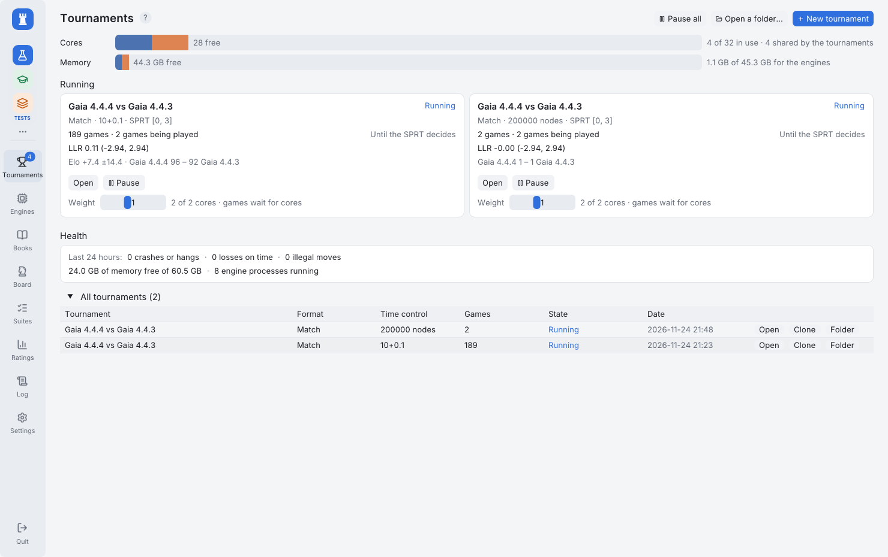 | 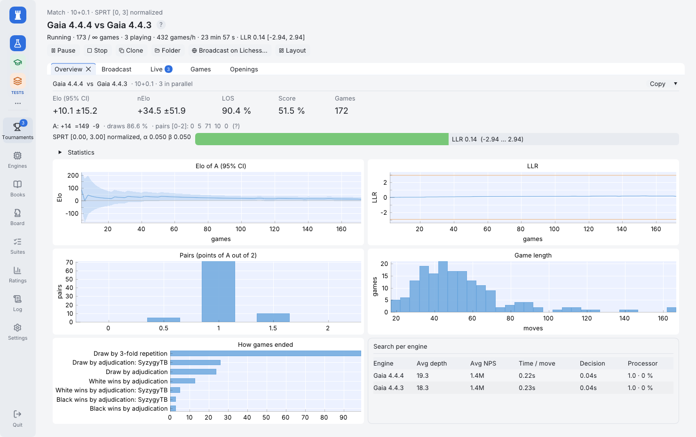 |

- Live view: every game in progress as a mosaic, or one in focus, with the board, the clocks, each engine's running
  search (depth, score, nodes, speed, win/draw/loss shares, PV in SAN), the annotated moves and the game graph; a big
  screen mode for a television or a stream. The processor time of every engine, with a warning when it uses more cores
  than its threads or thinks on its opponent's time.
- Broadcast: live PGN, HTML standings and JSON files, a TLCS server for TLCV and other viewers, a built-in web page (on
  the internet through a tunnel, without opening a port), and a Lichess broadcast of its own.

| The big screen, for a television or a stream | The broadcast's web page |
|---|---|
| 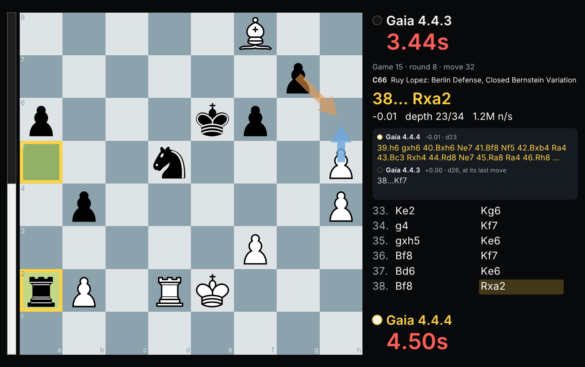 | 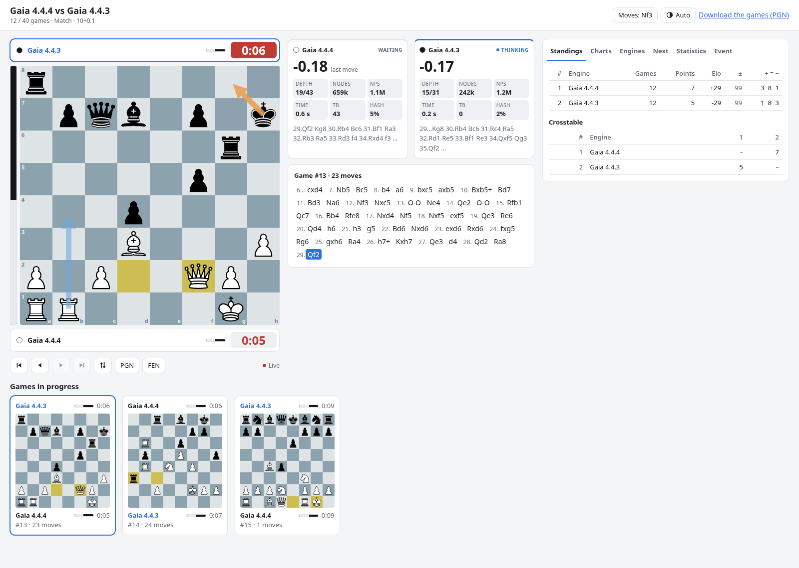 |

- Workflow: named profiles for each part of the setup (time control, openings, adjudication, format, engine settings)
  with presets for the usual rating list and fishtest conditions, templates, the engine library beside the
  participants, a queue, *Clone* and *Relaunch with…*, and a headless mode (`rookstudio --run`) for servers.
- Ratings over every tournament played (and imported PGN files), by time control, group or period, anchored on a
  reference Elo; an engine's card, head to head records, the progress of an engine's versions, an export for Ordo and
  BayesElo.
- Engines: UCI options read from the engine and edited in a table, a health check and fastchess' UCI compliance steps,
  groups, a reference Elo, the engine lists of other programs imported, a console. WinBoard engines too, through a
  translation to UCI built in. A rebuilt program is noticed, with what its new build changed. *Popular engines…*
  downloads the strongest engines whose authors publish builds on GitHub, in the build the processor runs, checked
  against their hash, and follows their new versions.
- Games: every finished game, filterable, with a replay board and the game graph, written to two PGN files (cutechess
  style, and `[%eval]` / `[%clk]` / `[%emt]`); a finished tournament's endgames checked against the tablebases (the wins
  let slip, the lost positions held, the draws adjudicated in a won position).

| A new tournament: a profile for each section, the engine library beside the participants | The engine library, with the UCI options the engine tells |
|---|---|
| 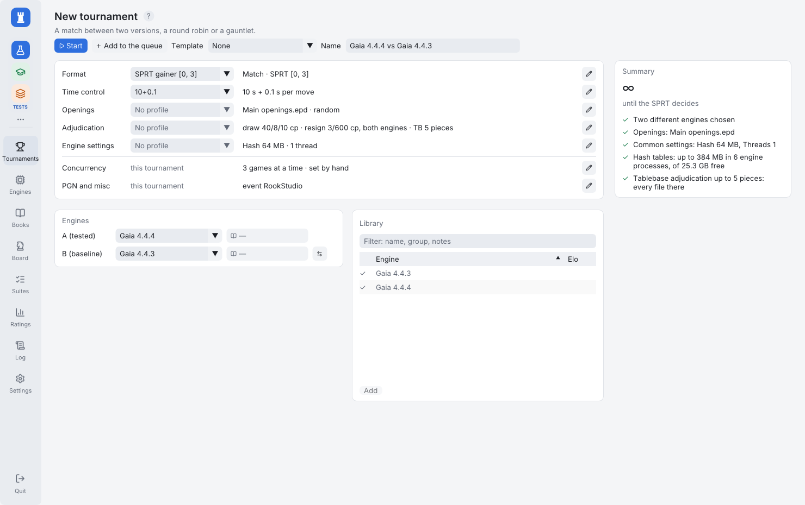 | 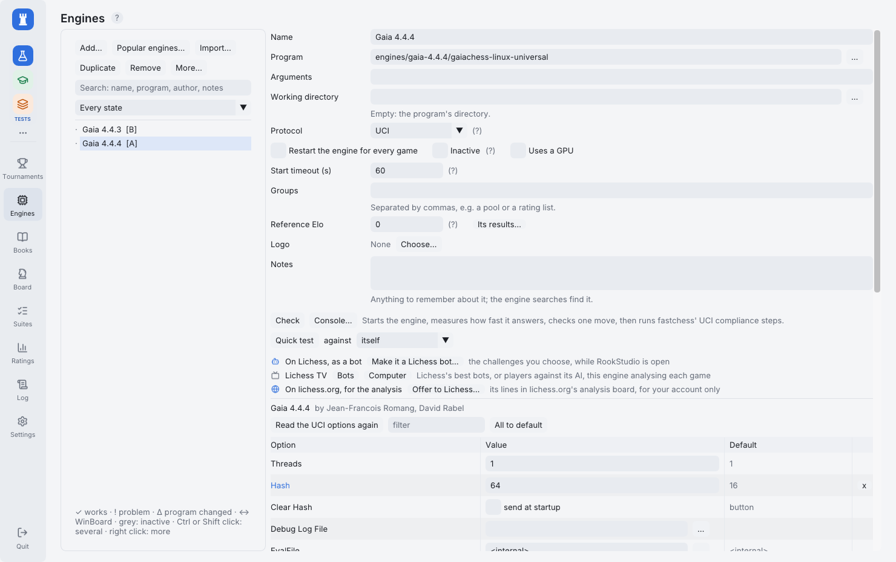 |

- The Board page of the Tests view: any position analysed by an engine of the library (several lines, the threat), any
  PGN file opened and replayed with its evaluations, a game graph (the analysis, each engine's evaluations, the book,
  the phases, the tablebase zone, the time of each move), a continuous analysis that sharpens at each pass, by one
  engine or several, and a review of each side's accuracy and key moments. A game between two engines, or between you
  and an engine, from any position.
- Opening books: EPD, PGN and Polyglot, checked for illegal, duplicate, mirrored and finished positions, browsed on a
  board, cleaned; CTG books read, and copied as Polyglot for the engines; Chess324 books, Polyglot books built from PGN
  files, books of Lichess's named openings or of its evaluated positions; results by opening after a tournament.
- Test suites (STS, WAC, ERET…): several engines on the positions of an EPD file, as a grid with the time to solution,
  saved to compare versions.

| The Board page: a game of the match analysed, its graph and this move | Its review: each side's accuracy, by phase too |
|---|---|
| 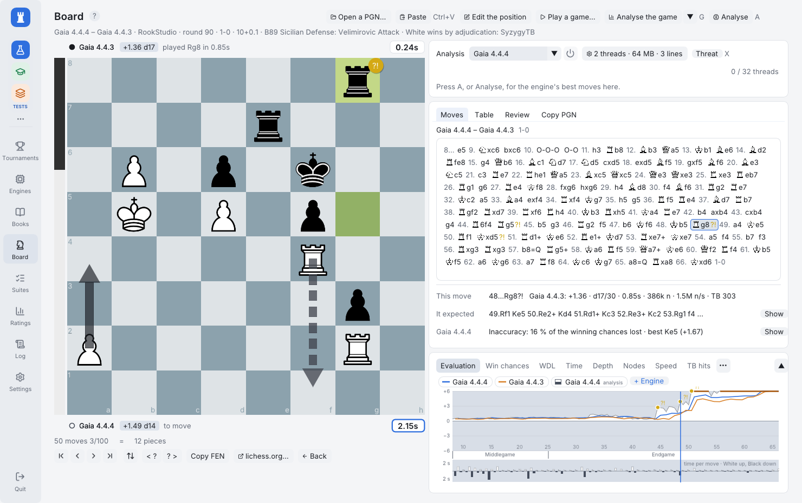 | 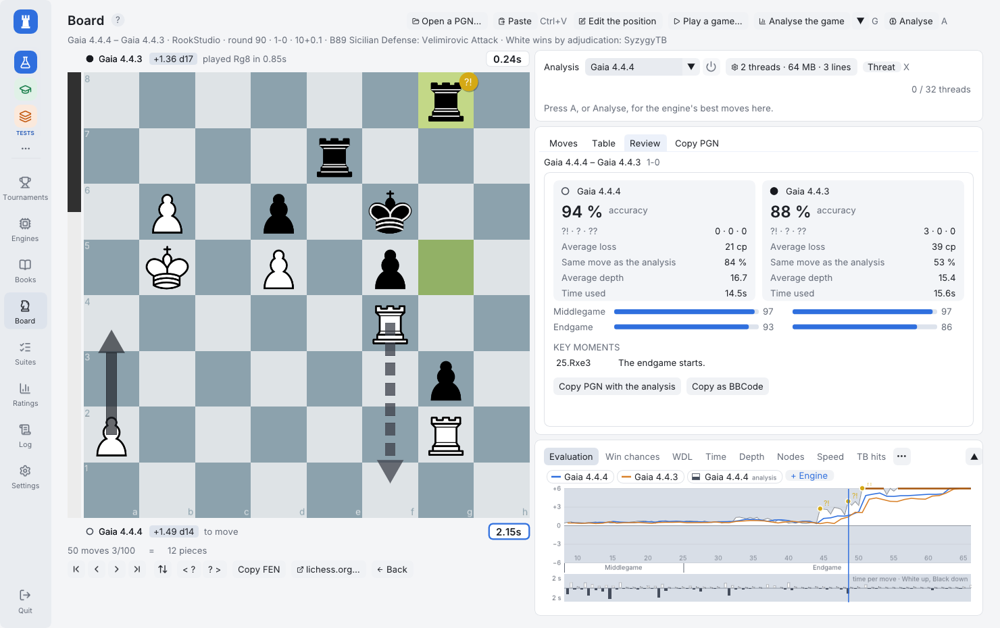 |

| An opening book checked, and browsed on a board | A test suite: two engines on classic combinations |
|---|---|
| 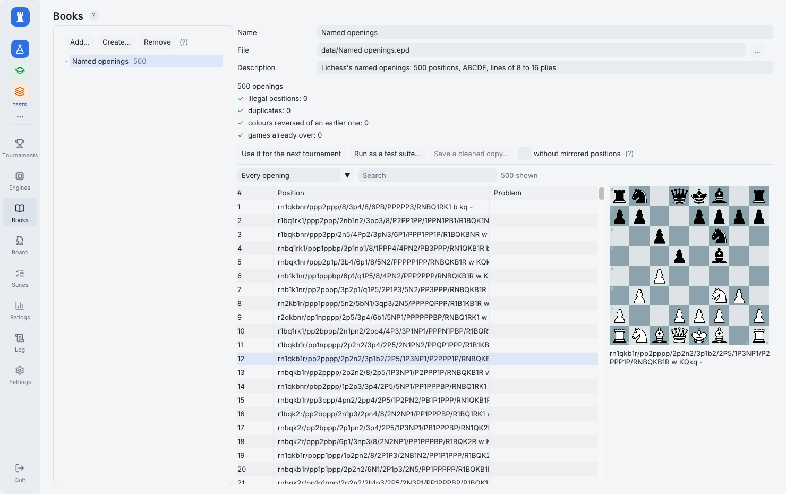 | 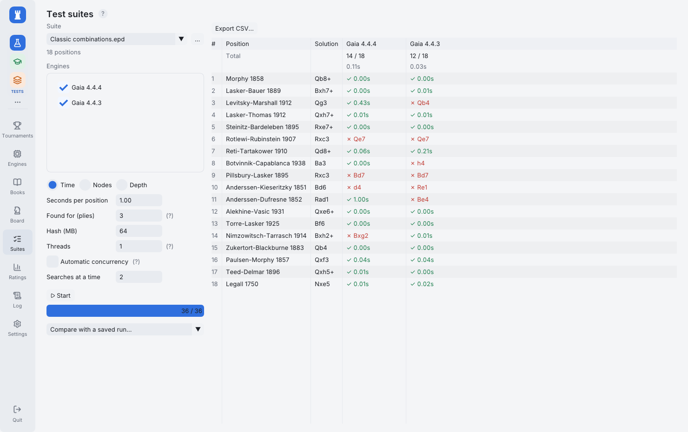 |

- Appearance: board colours, four piece sets or your own SVG pieces, move sounds, the engines' logos; the Board page's
  board can be drawn in 3D, path-traced on the graphics card and lit as in a photographer's studio.

| Settings › Appearance: the brown board and the Celtic pieces | The Board page in 3D: Botvinnik–Capablanca, AVRO 1938, before 30.Ba3 |
|---|---|
|  | 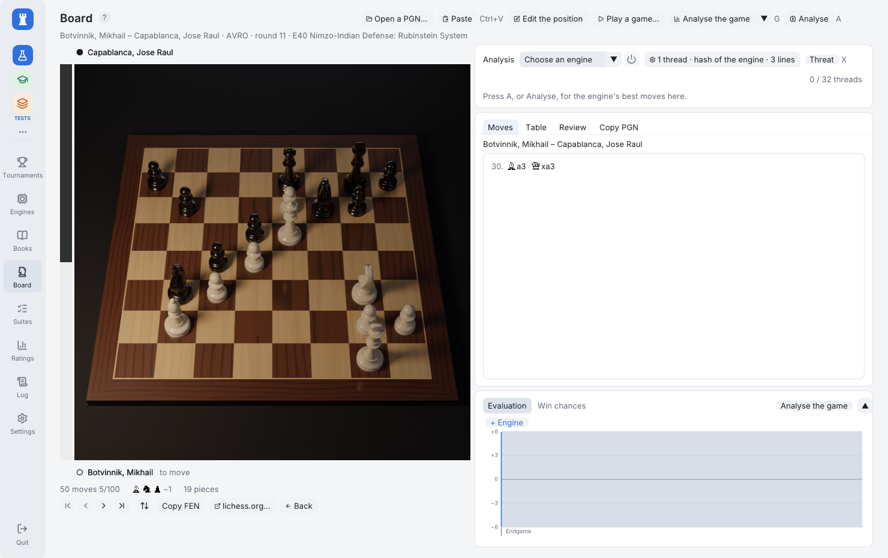 |

### Using it

1. Engines: *Add…* a UCI or WinBoard executable, *Import…* the engine list of another program, or *Popular engines…*.
   Options are read automatically.
2. Tournaments › New tournament: a profile for the format (a two-engine match, round robin, gauntlet, Swiss, knockout,
   team match), the time control, the openings, the adjudication and the engine settings; then the engines,
   double-clicked in the library beside the participants. In a match, engine A is the one being tested and engine B the
   baseline.
3. Start, or *Add to the queue*.

Everything is kept in the profile folder: `~/.local/share/rookstudio/` on Linux, `%APPDATA%\rookstudio\` on Windows,
`~/Library/Application Support/rookstudio/` on macOS. For a portable installation (a USB stick, a folder copied between
machines), put an empty file named `portable` beside the program: everything then goes into a `data` folder beside it.

### Relationship with fastchess

This is a fork of fastchess. The command line tool, its Makefile and its tests are untouched in behaviour. The program
only adds hooks that do nothing until an observer is installed (the command line tool never installs one):

- `app/src/core/observer.hpp`: the `GameObserver` interface (game start, thinking, the lines read from and sent to the
  engines, moves, game end, statistics) and the pair aware `PauseGate`;
- a worker index per thread in the thread pool, plus a fix for `ThreadPool::resize`, which created 2N entries for N
  threads;
- a ChessBase comment style in `PgnBuilder`;
- `Logger::setPrintSink`, which feeds the console window;
- `UciEngine::pid()` and `setInputCallback()`, for the processor time and the engine logs;
- on Windows, `CREATE_NO_WINDOW` when the parent has no console, so engines do not open console windows;
- `BaseTournament::saveJson()` does nothing without a configuration file name, so a tournament run by the program
  leaves no `config.json` next to its own files.

The tournaments themselves (schedules, pairings, journal, resume, standings, ratings) are a separate library,
`tournament/`, whose runner derives from fastchess' `BaseTournament` (see
[docs/design/tournament.md](docs/design/tournament.md)). The databases, the PGN reader and writer and the searches are
`study/` ([docs/design/study.md](docs/design/study.md)), the assistant's facts, templates and checker `commentary/`,
and its language model's runtime `assistant/`. How the code is organised, translated and tested is in
[docs/design/development.md](docs/design/development.md). The original fastchess README is kept as
[README.fastchess.md](README.fastchess.md).

## Help

The [user guide](docs/guide.md) covers every page, setting and file, with a quick start, the keyboard shortcuts,
troubleshooting and a glossary. It is built into the program, in every language of the interface, and follows the
version that runs: F1 opens it beside the page, at the section of what is under the mouse, with its contents, a search
and links between sections. Tooltips tell what a control does, and a problem the program reports names the engine, the
file or the resource, with its fix in place. *Report a problem…* opens a new issue in the browser, filled with the
version, the system and the end of the log, to read and complete before sending it.

| The guide beside the page, F1 at the section of what is under the mouse | In every language of the interface |
|---|---|
| 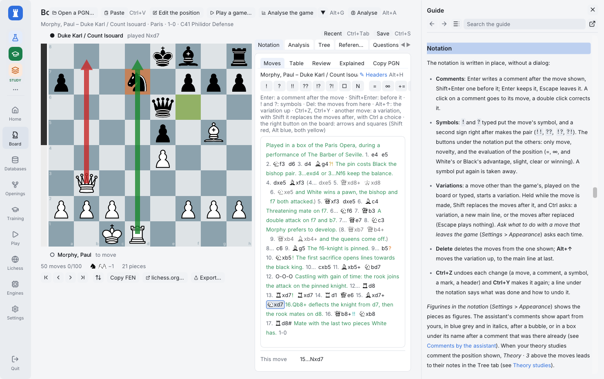 | 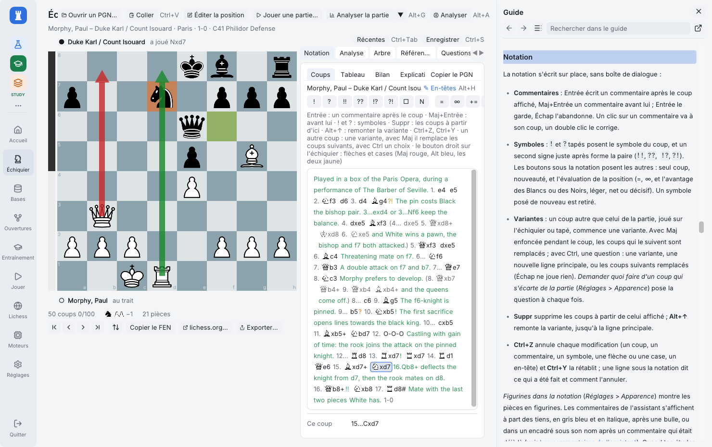 |

## Downloads

The programs are on the [releases page](https://github.com/jromang/rookstudio/releases), each preview a pre-release
with its notes: `rookstudio-<version>-linux-x86_64.tar.gz`, `rookstudio-<version>-windows-x86_64.zip` and
`rookstudio-<version>-macos-universal.zip`, with `SHA256SUMS.txt` to check them. Unpack the archive and keep its files
together: the assistant's runtime (llama.cpp) is in libraries beside the program.

- Windows: 64-bit Windows 10 version 1903 (May 2019) or newer. No installer, nothing else to install: run
  `rookstudio.exe`. The program is not signed, so SmartScreen may ask first (*More info*, *Run anyway*).
- Linux: x86-64, glibc 2.38 or newer (Ubuntu 24.04, Debian 13, Fedora 39, RHEL 10 or later), X11 or Wayland. OpenGL 3.2
  draws the window; without it (a virtual machine, a remote desktop), SDL's own renderer does, the processor alone if
  need be.
- macOS: macOS 13.3 (Ventura) or newer, Apple silicon and Intel (one universal application). It is not signed by an
  Apple developer account, so macOS refuses it the first time: Control-click (right-click) it, Open, then Open again; on
  macOS 15 and later, try to open it once, then System Settings, Privacy & Security, Open Anyway. Or run
  `xattr -dr com.apple.quarantine` on the unzipped folder.

The analysis needs an engine: with an empty library, the Analysis tab offers to download Gaia in a click, and the
Engines page lists the other popular engines.

## The assistant's model

The assistant's comments, stories, summaries and answers are written by a language model of its own, RookStudio
commentary v11 (`commentary-v11-Q4_K_M.gguf`, published on Hugging Face as
[jromanghf/rookstudio-commentary](https://huggingface.co/jromanghf/rookstudio-commentary), under the Apache-2.0
licence). It is optional, and downloaded only when you ask, from the first card of the Questions tab, of *Comment this
move* or of the review: about 2.7 GB on the disk and 3 GB of memory while it serves, checked when it arrives, a
download cut short resumed where it stopped.

It runs on your machine, in a process of its own: on the graphics card through Vulkan when there is one (a comment in
about a quarter of a second), else on the processor (about 3 seconds). It is loaded at the first question or comment
and unloaded after a quarter of an hour without serving, or with *Unload*; while a tournament uses the GPU, it answers
on the processor. Your games, your questions and its answers stay on the machine. Without it, everything else works,
and templates write the comments from the same facts.

## Privacy

Nothing leaves the machine without your action, and what does is said where you choose it.

- No account is needed. A Lichess account serves only what Lichess keeps to its members (your games there, your
  studies, its opening explorer, its puzzles online); it is linked in the browser, without a password, and its token
  stays in your profile, readable by you alone, revoked when you unlink it. Linked, RookStudio asks Lichess for your
  games in progress, to lock the aids while you play. Each other Lichess service (the cloud evaluations, the 7-piece
  tables, the explorer, the broadcasts) says what it sends when you first use it, and every request carries a
  User-Agent naming the program, never your personal data.
- Downloads happen when you ask for them: the assistant's model, Lichess's puzzles and evaluations, The Week in Chess, a
  chess.com player's games, FIDE's rating list, the endgame tables, an engine of *Popular engines…* (from its author's
  GitHub release, checked against its hash). None of these ships with RookStudio. *Popular engines…* reads its
  catalogue and the engines' latest releases on GitHub while its list is open; an engine added from it has its new
  versions looked for once a day, when the Engines page opens.
- *Tell me when a new version is out* is off by default. *Report a problem…* opens a filled issue in your browser, to
  read before sending it: the program sends nothing itself.
- The analysis, the assistant, the reviews, the reports and the exports run on your machine.

## Building from source

A C++20 compiler (gcc, clang or Apple clang), CMake 3.24 or newer and Ninja; Python 3 for the test runner. SDL3, Dear
ImGui (docking branch), ImPlot, nanosvg, stb, md4c, Mbed TLS, libssh2, QR Code generator, tinygettext, zstd, zlib, the
LZMA SDK, llama.cpp and the Inter and Lucide fonts are downloaded by CMake at pinned versions.

```bash
# Linux
cmake -B build -G Ninja -DCMAKE_BUILD_TYPE=Release
cmake --build build
./build/rookstudio

# macOS (Apple clang), a universal application
cmake -B build -G Ninja -DCMAKE_BUILD_TYPE=Release -DCMAKE_OSX_ARCHITECTURES="arm64;x86_64"
cmake --build build
open build/RookStudio.app

# Windows, cross-compiled from Linux with mingw-w64
cmake -B build-win -G Ninja -DCMAKE_BUILD_TYPE=Release -DCMAKE_TOOLCHAIN_FILE=cmake/mingw-w64.cmake
cmake --build build-win
```

The assistant's runtime is built by default (`-DFCG_ASSISTANT=OFF` leaves it out), as shared libraries beside the
program, with llama.cpp's processor backend; `-DFCG_ASSISTANT_VULKAN=ON` adds its Vulkan backend (the Vulkan headers
and loader, glslc and SPIRV-Headers). The build also produces `fastchess`, the upstream command line tool from the same
sources, and the test programs:

```bash
cmake --build build --target check             # every test case of every program, each in a process of its own
./build/fcg-tournament-tests                   # the tournament library: schedules, journal, resume, pairings, ratings
./build/fcg-study-tests                        # databases, PGN, searches, the opening tree
./build/fcg-commentary-tests                   # the assistant's facts, templates and checker
./build/fastchess-gui-tests                    # the program, including real tournaments with a mock engine
make -C app tests && ./app/fastchess-tests     # upstream fastchess tests, run from the repository root
```

The build goes through ccache when it is installed.

## Roadmap

RookStudio comes in previews, each a step of the plan:

- Preview 1: the views, databases and their searches, the notation written in place, the opening tree and repertoires,
  Lichess (the account, a player's games, the cloud evaluations and the tables, the broadcasts), the assistant.
- Preview 2: ChessBase databases and CTG books, games from their sources, the training of a repertoire, theory studies,
  four engines side by side, Lichess studies, Lichess's evaluations offline, the story of a game told by the model.
- Preview 3: the Training page (puzzles, your mistakes, guessing the moves, endgames against the tables, mates, board
  vision), the Play page (against an engine, and your games on Lichess), an engine as a Lichess bot, Lichess TV.
- Preview 4: the maintenance of a database, the advanced searches, players' dossiers, opening reports, crosstables,
  publishing (HTML, PNG and SVG, GIF, PDF), every move explained and the guided visit, practical moves, the Endgames
  tab, Lichess's arenas and Swiss tournaments, your engine on lichess.org's analysis board; and the repository made
  public.

Next, a fifth preview of feedback and finishing touches: what testers report once the repository is public; DGT boards
and voice input, to be decided after trying them on real hardware; the assistant's comments in the six other languages
of the interface, which needs phrasebooks for each and a new training of its model; more of Lichess (the token's
permissions, bookmarks synced both ways, notes on players). Then 1.0, when RookStudio replaces fastchess-gui: a last
fastchess-gui release pointing here, and its repository archived.

## Licence and credits

RookStudio is under the MIT licence, like fastchess (see [LICENSE](LICENSE)).

- [fastchess](https://github.com/Disservin/fastchess), by Disservin and its contributors (MIT), plays the tournaments,
  with the libraries it brings: chess-library, JSON for Modern C++, fmt, Pyrrhic.
- The libraries fetched at build time: SDL 3 (zlib), Dear ImGui and ImPlot (MIT), nanosvg (zlib), stb (MIT or public
  domain), md4c (MIT), Mbed TLS (Apache-2.0), libssh2 (BSD-3-Clause), QR Code generator (MIT), tinygettext (zlib), zstd
  (BSD-3-Clause), zlib (zlib), the LZMA SDK (public domain), llama.cpp and ggml (MIT).
- The reading of ChessBase databases is ported from cbvault (MIT); the CTG reader is written for RookStudio.
- The pieces: Cburnett by Colin M.L. Burnett (BSD 3-clause), Chessnut by Alexis Luengas (Apache 2.0), Celtic and
  Fantasy by Maurizio Monge (MIT), as the Lichess project optimized them; the 3D board's pieces are clarkerubber's
  Staunton-Pieces (MIT), its tone mapping Benjamin Wrensch's AgX (MIT). The fonts: Inter (SIL Open Font License 1.1) and
  Lucide (ISC).
- The data: Lichess's named openings (chess-openings, CC0) are built in. Lichess's puzzles, evaluations and games (CC0)
  and its broadcasts (CC BY-SA 4.0), The Week in Chess (free for personal use), Lumbra's Gigabase (CC BY-NC 4.0) and
  FIDE's rating list are never shipped: they come only when you ask for them. The tie-breaks, performances and rating
  changes follow FIDE's regulations.
- The assistant's model, RookStudio commentary v11, is under the Apache-2.0 licence.

[gui/assets/ATTRIBUTION.md](gui/assets/ATTRIBUTION.md) gives every notice, and `sbom/` the components with their
versions. The screenshots show old masters' games (in the public domain), games of invented players and Gaia's own
games.
